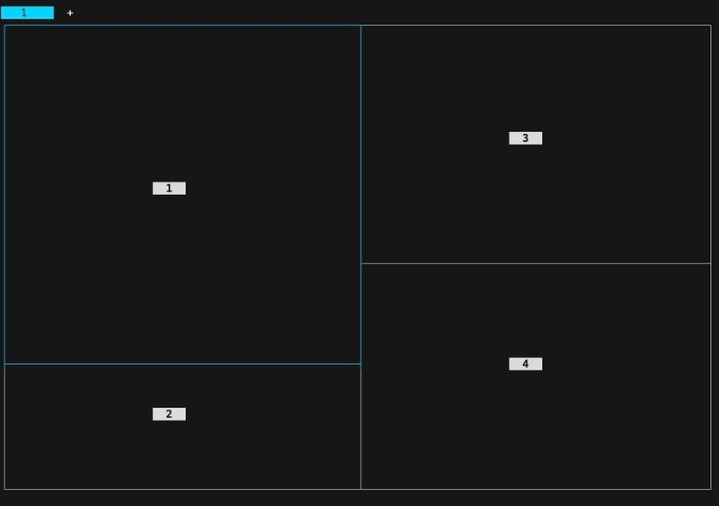

# herdr-select-layout

A [herdr](https://herdr.dev/) plugin that rearranges the panes of a tab like tmux's
`select-layout`, with one key.



| Action | tmux | Result |
|---|---|---|
| `even-horizontal` | `prefix M-1` | all panes in one row, equal widths |
| `even-vertical` | `prefix M-2` | all panes in one column, equal heights |
| `main-horizontal` | `prefix M-3` | the main pane on top, the others side by side below |
| `main-vertical` | `prefix M-4` | the main pane on the left, the others stacked on the right |
| `tiled` | `prefix M-5` | a grid that is never taller than wide |
| `next` | `prefix Space` | the next layout, in the order above |
| `spread` | `prefix E` | keep the arrangement, give every pane the same share |

`tiled` uses `cols = ceil(sqrt(n))` and `rows = ceil(n / cols)`:

```
3 panes        5 panes          7 panes
┌────┬────┐    ┌──┬──┬──┐       ┌──┬──┬──┐
│ 1  │ 2  │    │1 │2 │3 │       │1 │2 │3 │
├────┴────┤    ├──┴┬─┴──┤       ├──┼──┼──┤
│    3    │    │ 4 │ 5  │       │4 │5 │6 │
└─────────┘    └───┴────┘       ├──┴──┴──┤
                                │   7    │
                                └────────┘
```

A short last row spreads over the full width.

The main pane is the first pane (top-left), as in tmux, and is 80 cells wide or 24 rows high
by default (tmux's `main-pane-width` and `main-pane-height`); see [Configuration](#configuration).

Panes keep their order, top-left first, and their running processes and scrollback. A
zoomed pane is unzoomed (as in tmux) and focus stays on the pane that had it.

## Install

```bash
herdr plugin install cremarch/herdr-select-layout
```

Bind the actions in `~/.config/herdr/config.toml`, for example to tmux's keys:

```toml
[[keys.command]]
key = "prefix+alt+1"
type = "plugin_action"
command = "cremarch.select-layout.even-horizontal"
description = "even horizontal"

[[keys.command]]
key = "prefix+alt+2"
type = "plugin_action"
command = "cremarch.select-layout.even-vertical"
description = "even vertical"

[[keys.command]]
key = "prefix+alt+3"
type = "plugin_action"
command = "cremarch.select-layout.main-horizontal"
description = "main horizontal"

[[keys.command]]
key = "prefix+alt+4"
type = "plugin_action"
command = "cremarch.select-layout.main-vertical"
description = "main vertical"

[[keys.command]]
key = "prefix+alt+5"
type = "plugin_action"
command = "cremarch.select-layout.tiled"
description = "tiled"

[[keys.command]]
key = "prefix+space"
type = "plugin_action"
command = "cremarch.select-layout.next"
description = "next layout"

[[keys.command]]
key = "prefix+shift+e"
type = "plugin_action"
command = "cremarch.select-layout.spread"
description = "spread panes evenly"
```

```bash
herdr server reload-config
```

`alt+…` needs the terminal to send Option as Alt on macOS (Ghostty: `macos-option-as-alt`).

Or run an action once on the focused tab:

```bash
herdr plugin action invoke cremarch.select-layout.tiled
```

## Configuration

Optional. Put a `config.toml` in the plugin's config directory, which
`herdr plugin config-dir cremarch.select-layout` prints. It is read on every run, so no
reload is needed.

```toml
main_pane_width  = 80        # main-vertical: cells, or a percentage such as "60%"
main_pane_height = 24        # main-horizontal: rows, or a percentage
main_pane        = "first"   # "first" (top-left, as tmux) or "focused"
tiled            = "wide"    # "wide": never taller than wide; "tall": never wider than tall
```

Only flat `key = value` lines are read: integers and double-quoted strings. A main pane size
is kept between 5% and 95% of the tab. An unknown key or value is reported as an error
rather than ignored.

## How it works

herdr cannot move a pane within its own tab, so the plugin parks every pane but the first in
a temporary tab and moves each one back next to its new neighbour (`pane.move`), then sets
the split ratios (`layout.set_split_ratio`). The temporary tab shows in the tab bar while
this runs (well under a second for a handful of panes); herdr closes it once it is empty.
`layout.apply` is not used because it replaces the panes with new ones, losing their
processes.

- When the tab already has the wanted arrangement, no pane is moved, and ratios that are
  already right are not rewritten.
- If a move fails half way, the parked panes are moved back into the tab before the error
  is reported, so no pane is left behind in the temporary tab.
- Runs on the same tab are serialized: pressing the key again while a run is in progress
  does nothing.
- Errors are shown as a herdr notification and kept in the plugin log
  (`herdr plugin log list --plugin cremarch.select-layout`).

## Requirements

- herdr 0.9.5 or later
- Perl 5.14 or later with core modules only (the system Perl on macOS and Linux)
- macOS or Linux (herdr's Windows named pipes are not supported yet)

## Development

```bash
prove -l t                                   # unit tests against an in-memory fake herdr
HERDR_INTEGRATION=1 prove -l t/integration.t # against the running herdr, in a scratch tab
herdr plugin link "$PWD"                     # use the checkout as the installed plugin
./select-layout --help
```

| File | Role |
|---|---|
| `select-layout` | command line entry point used by the actions |
| `lib/Herdr/SelectLayout.pm` | the sequence of herdr calls for one run |
| `lib/Herdr/SelectLayout/Layout.pm` | pure layout computations: wanted tree, moves, ratios |
| `lib/Herdr/SelectLayout/Config.pm` | `config.toml` |
| `lib/Herdr/SelectLayout/Client.pm` | herdr socket client |
| `t/lib/FakeHerdr.pm` | in-memory herdr for the unit tests |

## License

MIT
